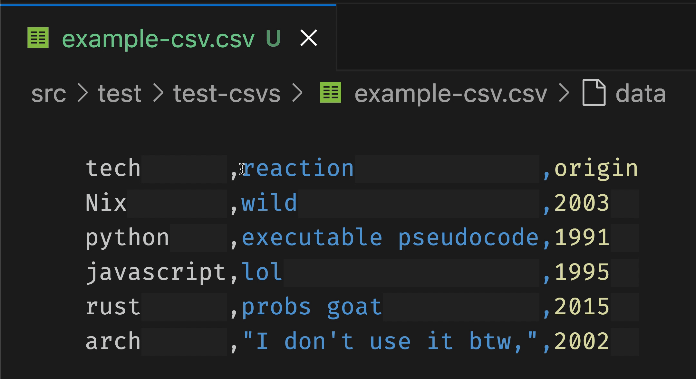

A VSCode extension that uses the inlay hints to
render csvs as columns.


**Tip: We recommend that this is used with the rainbow csv extension, which will color the columns.**

A CSV like this:

```csv
grant,murphy,whaddup,1234,dog
d-train,mochi,hi,1,kitten
```

Would be rendered like this:

```csv
grant  ,murphy,whaddup,1234,dog
d-train,mochi ,hi     ,1   ,kitten
```

## Features

### Deleting Columns



## To Do / Known Issues

- [The GH Issues](https://github.com/GSmithApps/csv-aligner/issues)
- Separators other than commas, and `.tsv` files, should work as of 0.3.0
  (see [issue 3](https://github.com/GSmithApps/csv-aligner/issues/3)). If you
  hit a delimiter that still doesn't align, please file an issue.
- If the CSV appears to render poorly like shown in [this issue](https://github.com/GSmithApps/csv-aligner/issues/5),
  please put the following into your user settings JSON config.

```json
"[csv]": {
  "editor.inlayHints.maximumLength": 0
}
```

- If you have that setting in place and a **very wide** CSV (roughly 35+
  columns) still loses its hints on every row below the first screenful,
  that's a different problem and the setting won't help. VS Code stops
  drawing after 1500 inlay hints, and a wide file needs more than that for
  one screen. There's no workaround from your side yet; see "Why wide files
  lose their hints" in CONTRIBUTING.md for the details.

## Release Notes

### 0.4.0

- Column widths are now based on the whole file instead of the rows near
  your viewport, so a column keeps the same width no matter where you
  scroll. This reverses the width behavior from 0.3.2, where widths shifted
  as you scrolled.
- Widths now shrink back down after you delete a long value, instead of
  staying wide.
- The delimiter is detected once per file from a sample of the first lines,
  rather than by parsing the entire file (which was most of the cost on
  large CSVs) and rather than being re-guessed for each screenful.
- Big files use much less memory. The width scan no longer builds a table
  of every cell in the document, so wide files that previously could
  exhaust memory now scan in a fraction of a second.
- Widths are cached per file and recomputed only when you edit, so
  scrolling doesn't rescan.
- Known limitation, unchanged by this release: on very wide CSVs (roughly
  35+ columns) the rows below the first screenful lose their hints
  entirely. VS Code silently stops drawing after 1500 inlay hints. See
  "Why wide files lose their hints" in CONTRIBUTING.md, and
  [issue 5](https://github.com/GSmithApps/csv-aligner/issues/5).

### 0.3.2

- Fixed hint calculation so it only parses the visible window (plus a
  buffer) instead of everything from the top of the file down. Scrolling
  deep into a large CSV no longer gets slower the further you go.
- Column widths are now based on the rows near your viewport, so they
  can shift as you scroll rather than only ever growing.

### 0.3.1

- mistyped a version number

### 0.3.0

- I _believe_ it works for other delimiters and .tsv files now

### 0.2.0

- It works for bigger files now

### 0.1.1

- Added a gif and features section to the readme.

### 0.1.0

Solved [top issue](https://github.com/GSmithApps/csv-aligner/issues/1),
we think it's working with commas in cell values now.

It doesn't seem to handle different separators very well.
That's in progress.

### 0.0.9

Experimenting with CICD in github.

### 0.0.8

VSCode was updated and the
default inlay hint truncation
was removed

### 0.0.7

Enhanced README

### 0.0.6

Lol put in an icon.

### 0.0.5

Learned that VSCode October 2024 release fixes the inlay hint truncation.
See [VSCode issue 205708](https://github.com/microsoft/vscode/issues/205708).


## Contributors

- Big thanks to [Noé SELLAM](https://github.com/GDGiantDwarf)
  for filing the first issue!!

## Support

If you like CSV Aligner, please consider paying
it forward by taking a pledge at [Giving What We Can](https://www.givingwhatwecan.org/pledge?c=header)
or donating to [GiveWell](https://secure.givewell.org).

Or you support the project directly at PayPal 😄
[](https://paypal.me/GSmithApps?country.x=US&locale.x=en_US)
